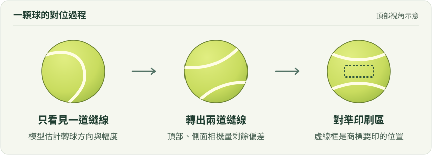

# 網球商標印刷前的視覺對位系統

網球進入對位機台時，每顆球的縫線朝向都不同。為了把商標印在兩道縫線之間，機台得先轉球，把適合印刷的那一面朝上。前代機台已能自動對位，但經常逾時排球，現場人員得把球收回重投。改良後，普通綠球實機測試的**平均對位時間從 8.392 秒縮短至 3.239 秒，降幅為 61.4%。對位超過 10 秒的比例從 31.93% 降至 0.42%。**

**專案分工**　陳和欽在碩士論文期間接手既有設備，是該屆學校端唯一的開發者，負責開發資料蒐集與標註工具、訓練模型，以及改寫機台的 C# 控制程式。機構改良方面，陳和欽提出改善建議，由合作廠商測試與修改。廠商負責機構設計製造、配線與工業控制器（PLC），並將在測試機上確認的版本更新到產線設備。

## 網球如何完成對位

**粗對位。** 頂部相機只看見一道縫線時，姿態模型根據縫線輪廓估計旋轉角度與滾動量，讓機台先把球轉到看得見兩道縫線的位置。如果進球時已經看得見兩道可供定位的縫線，控制程式就直接進入微調。

**雙相機微調。** 滾輪與球面之間可能打滑，球實際停下的位置會和預期有偏差。頂部相機量測縫線傾角與中心偏移，側面相機量測縫線的垂直偏移。控制程式依量到的偏差轉球，再重新取像確認，直到位置與角度都落在設定範圍內。

第一次微調後，程式會依球種檢查朝上的球面。普通綠球要避開影響印刷的殘膠，多色球則要確認指定顏色朝上。球面和位置都符合條件後，機台才通知下一站壓印。

## 姿態估計與取像控制的改良

### 用機台動作標記球面姿態，將粗對位由兩步合為一步

單看一張球面照片，很難靠肉眼判定球相對於參考姿態轉了多少。資料蒐集程式讓球從參考姿態出發，依序旋轉、滾動、再旋轉，並將三個控制參數與當下的縫線影像一起儲存。透過這個方法，約 5～6 顆球就提供了 229,860 張帶有動作標籤的姿態影像。

我用這批資料訓練雙分支 EfficientNet-B3。兩個分支分別從清晰圖擷取縫線邊緣、從模糊圖擷取整體走向。合併特徵後，模型一次估計初始旋轉角度、滾動量與後續旋轉角度，C# 控制程式據此將前代分兩步執行的粗對位合為一步。[姿態標籤與模型設計](docs/engineering.md)

### 重寫取像與控制流程，讓微調使用最新可用的影像

前代由多個背景工作串接取像、影像判斷與機構動作，工作之間經常彼此等待，拖慢對位流程。粗對位加快後，調機時也更常看到球已轉動，微調卻仍根據較早的影像計算。即使幾何計算正確，算出的修正量也只適用於拍攝當時的球面姿態。

我保留並改良既有的雙相機幾何微調，重寫了影像交接與啟動判斷的流程。新版由頂部相機持續更新影像，主控制迴圈取出最新可用的一幀，依馬達與對位狀態決定是否送出分析。[影像交接設計與改寫前後的四批實測](machine-control/README.md)

## 實機測試結果

| 普通綠球對位測試    |    前代系統 |     改良後 |
| ----------- | ------: | ------: |
| 對位試次        |  10,423 |  29,745 |
| 平均對位時間（含逾時） | 8.392 秒 | 3.239 秒 |
| 逾時次數（超過 10 秒） |   3,328 |     124 |
| 逾時比例       |  31.93% |   0.42% |

兩版均從同一袋混合批次的普通綠球取球，從相機取像計時至該次對位結束。依當時的操作記憶，測試時關閉了顏色與殘膠檢查。耗時差異反映模型、轉球流程與程式調度一併改良後的表現。

殘膠辨識另做了 200 次實機測試。以人工判讀為準，系統判對 195 次，**整體正確率為 97.5%**。其中 25 次球面有膠，系統漏判 5 次；其餘 175 次無膠均判斷正確。[測試條件與判斷結果](docs/evaluation.md#殘膠辨識的實機正確率)

## 機台控制說明與模型程式碼

考量產學合作廠商的營業秘密，機台端 C# 原始碼未公開。兩個模型各自在 Python 中訓練，匯出為 ONNX 後由 C# 在機台的 CPU 上執行推論。

- [C# 機台控制說明](machine-control/README.md) 涵蓋雙相機取像、馬達控制與實機測試。
  - [姿態對位模型](machine-control/alignment-training/README.md) 從縫線輪廓估計粗對位動作。
  - [殘膠模型](machine-control/residue-training/README.md) 標出球面殘膠，供控制程式判斷是否需要翻面。
    - [半自動遮罩標註工具](machine-control/residue-training/annotation-tool/README.md) 用來圈選殘膠、修整邊界，製作殘膠模型的訓練標籤。
